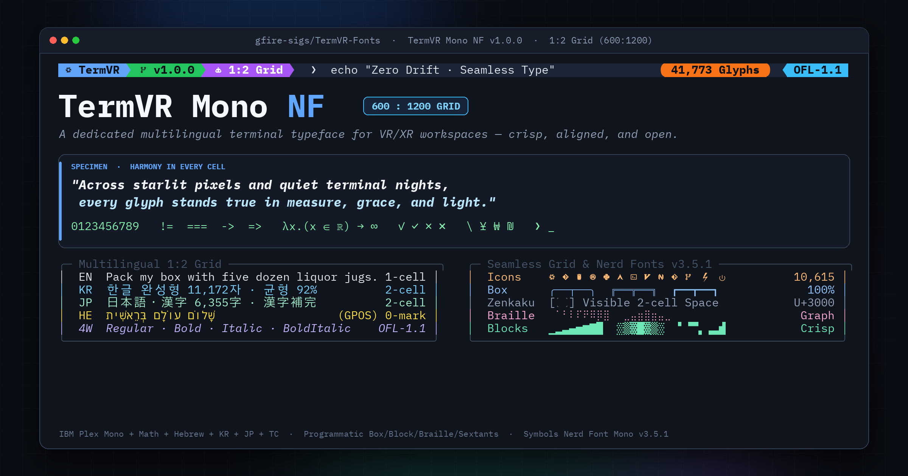
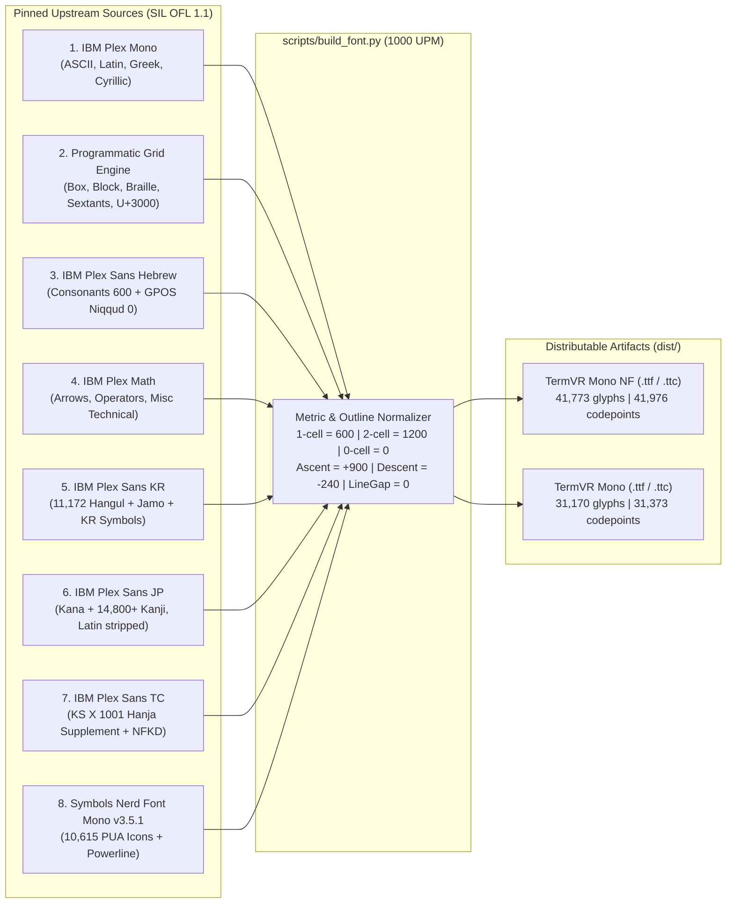

# TermVR Mono & TermVR Mono NF

[](https://github.com/gfire-sigs/TermVR-Fonts/actions/workflows/build.yml)
[](LICENSE)



**`TermVR Mono`** and **`TermVR Mono NF`** are the dedicated default terminal font families engineered for **`gfire-sigs/TermVR`**.

Built on a strict **1:2 (`600 : 1200` @ `1000 UPM`) integer cell grid**, TermVR Mono unifies **IBM Plex Mono**, **IBM Plex Math**, **IBM Plex Sans Hebrew**, **IBM Plex Sans KR**, **IBM Plex Sans JP**, **IBM Plex Sans TC** (KS X 1001 Korean Hanja supplement), **programmatically generated terminal grid geometry**, and **Nerd Fonts (`v3.5.1`)** into a single self-contained, zero-drift multilingual terminal typeface for VR/XR and desktop terminal emulators.

---

## Key Highlights

- **Strict `1:2` Integer Cell Grid (`600 : 1200` @ `1000 UPM`)**:
  - `wcwidth == 0` (Combining marks, Hebrew *Niqqud* `U+0591`–`U+05C7`, Hangul Jungseong/Jongseong) → **`0` units**
  - `wcwidth == 1` (ASCII, Latin, Greek, Cyrillic, Hebrew consonants, Halfwidth Katakana, Math/Technical symbols, Box Drawing, Braille, Nerd Font PUA icons) → **`600` units**
  - `wcwidth == 2` (Hangul syllables, Compatibility Jamo, Hiragana, Katakana, CJK Unified & Compatibility Ideographs, `U+3000` Ideographic Space) → **`1200` units**
- **Seamless Subpixel-Free Terminal Grid Geometry (`U+2500`–`U+259F`, `U+2800`–`U+28FF`, `U+1FB00`–`U+1FB3B`)**:
  - `477` box drawing, block element, Braille, and legacy computing sextant glyphs are mathematically synthesized directly against the `(600, 1140)` cell box (`x ∈ [0, 600]`, `y ∈ [-240, +900]`, `LineGap = 0`).
  - Single-contour non-overlapping outlines ensure `tmux`, `zellij`, `btop`, `lazygit`, and `neovim` borders connect with zero gaps or double-darkened seams under VR 3D MSDF/Signed-Distance-Field shaders.
  - Rounded corners (`╭ ╮ ╯ ╰`, `U+256D`–`U+2570`) use true quadratic Bézier arcs meeting cell edges at exact $90^\circ$ tangents.
- **Hebrew Terminal Support with Dual-Mode *Niqqud* (`GPOS` + Non-`GPOS`)**:
  - Hebrew consonants (`U+05D0`–`U+05EA`) and presentation forms (`U+FB1D`–`U+FB4F`) are normalized to `600` units (`85%` cell fill).
  - Hebrew vowel points (*Niqqud*, `U+05B0`–`U+05C7`) are zero-width (`advanceWidth = 0`) with both their outlines and `GPOS` `MarkToBase` (`'hebr'` script) anchors shifted by `-300` units, so vowel points center cleanly under/over the preceding consonant in both HarfBuzz (`GPOS`-enabled) and simple cell-by-cell VR terminal renderers.
- **Optically Balanced Korean, Japanese & Hanja (`KR` + `JP` + `TC`)**:
  - `IBM Plex Sans KR` (`892` native width → `1200` cell, `92%` optical scale) and `IBM Plex Sans JP` (`1000` native width → `1200` cell, `90%` optical scale) are baseline-harmonized (`y_center ≈ +330`) so mixed Korean + Japanese + English lines share uniform visual density.
  - **Crucial safeguard**: `IBM Plex Sans JP`'s 105%-scaled proportional Latin/Greek/Cyrillic glyphs (`< U+2000`) are completely stripped so base `IBM Plex Mono` remains pure.
- **Ambiguous-Width & Special Terminal Character Protections**:
  - `U+005C` (`\`) is strictly preserved as a true ASCII backslash (never overwritten with `¥` or `₩`).
  - `U+3000` (Ideographic / Zenkaku Space) has exact `1200` fullwidth advance with subtle corner ticks (`opacity ~25%` visual weight) to immediately expose accidental fullwidth spaces in code/CLI input.
  - `U+274C` (`❌`) and `U+2705` (`✅`) monochrome halfwidth overrides are stripped so terminals defer them to system Color Emoji (`wcwidth = 2`), while `U+2713`–`U+2718` (`✓ ✔ ✕ ✖ ✗ ✘`) are guaranteed 1-cell (`600`) monochrome vector glyphs.

---

## Architecture & Synthesis Pipeline



---

## Font Metrics Specification

| Parameter | Value | Rationale |
| :--- | :--- | :--- |
| **`unitsPerEm` (UPM)** | `1000` | Native UPM of the IBM Plex family; prevents floating-point rounding drift on base outlines |
| **1-Cell Width (Halfwidth)** | `600` (`0.6 em`) | Native advance width of `IBM Plex Mono` |
| **2-Cell Width (Fullwidth)** | `1200` (`1.2 em`) | Exact `2 × 600` integer multiple for Hangul, Kana, and CJK Ideographs |
| **0-Cell Width (Combining)** | `0` | Zero advance width for `Mn`/`Me`/`Cf` marks and Hebrew *Niqqud* |
| **`Ascender`** (`hhea` / `sTypo` / `usWinAscent`) | `+900` | Accommodates tall CJK frames, Hebrew upper cantillation, and seamless vertical box lines |
| **`Descender`** (`hhea` / `sTypo` / `-usWinDescent`) | `-240` | Accommodates Hebrew lower *Niqqud* (`U+05B0`–`U+05BB`) and `g`/`j`/`p`/`q`/`y` descenders |
| **`LineGap`** (`hhea` / `sTypoLineGap`) | `0` | Mandatory for gap-free vertical box drawing (`│`, `█`, Powerline ``) across rows |
| **Total Cell Box (`W × H`)** | `600 × 1140` (1-cell) / `1200 × 1140` (2-cell) | Fixed-pitch `post.isFixedPitch = 1`, `PANOSE bProportion = 9`, `BASE` table removed |

---

## Special Character Sourcing & Guardrails

| Category | Unicode Range / Codepoints | Source | Cell Width | Design Treatment |
| :--- | :--- | :--- | :---: | :--- |
| **Box Drawing & Rounded Corners** | `U+2500`–`U+257F` (`128` chars) | `generate_terminal_glyphs.py` | `600` | Exact `[0, 600] × [-240, 900]` span; single-contour unions; true quadratic Bézier arcs (`╭╮╯╰`) |
| **Block Elements & Shades** | `U+2580`–`U+259F` (`32` chars) | `generate_terminal_glyphs.py` | `600` | Exact fractional fills (`1/8`..`7/8`) & crisp vector dot matrices (`░▒▓`) |
| **Braille Patterns** | `U+2800`–`U+28FF` (`256` chars) | `generate_terminal_glyphs.py` | `600` | Uniform $2 \times 4$ grid (`X = {180, 420}`, `Y = {720, 460, 200, -60}`, $R = 56$) for `btop` graphs |
| **Legacy Computing Sextants** | `U+1FB00`–`U+1FB3B` (`60` chars) | `generate_terminal_glyphs.py` | `600` | Seamless $2 \times 3$ sub-block mosaic grid (`X ∈ [0, 300, 600]`, `Y ∈ [-240, 140, 520, 900]`) |
| **Ideographic Space (Zenkaku)** | `U+3000` (`1` char) | `generate_terminal_glyphs.py` | `1200` | Overwrites IBM Plex Mono's erroneous `600`-width space with `1200`-width subtle corner ticks |
| **Currency & Backslash** | `\` `U+005C`, `¥` `U+00A5`, `₩` `U+20A9`, `₪` `U+20AA`, `￥` `U+FFE5`, `￦` `U+FFE6` | `Mono` / `KR` / `Hebrew` / `JP` | `600` / `1200` | `U+005C` is strictly preserved as `\`; halfwidth/fullwidth currencies separated by codepoint |
| **CLI Check / Cross Dingbats** | `U+2713`–`U+2718` (`✓ ✔ ✕ ✖ ✗ ✘`) | `Mono` + `Math` + `Nerd Fonts` | `600` | Always included in both `TermVR Mono` and `TermVR Mono NF`; `U+274C`/`U+2705` deferred to Color Emoji |
| **Math & Technical Symbols** | `U+2190`–`U+23FF`, `U+25A0`–`U+27BF` | `IBM Plex Math` + `Nerd Fonts` | `600` | Native 1-cell arrows, operators, geometric shapes, and prompt chevrons (`❯`, `⚡`, `⏻`) |
| **Developer Icons & Powerline** | `U+E000`–`U+F8FF`, `U+F0000`–`U+FFFFD` | `SymbolsNerdFontMono v3.5.1` | `600` | `10,615` icons scaled from `2048` → `1000` UPM; Powerline `U+E0B0`–`U+E0D7` spans `[-240, 900]` |

---

## Measured Language & Character Coverage (`v1.0.0`)

Verified automatically by [`scripts/verify_font.py`](scripts/verify_font.py):

| Script / Standard | Target Set | Mapped in `TermVR Mono NF` | Coverage |
| :--- | :--- | :---: | :---: |
| **ASCII & Basic Latin** | `U+0020`–`U+007E` (`95` chars) | `95 / 95` | **100.0%** |
| **Latin-1 / Extended-A / B / Additional** | Pan-European & Vietnamese | `935 / 935` | **100.0%** |
| **Modern Korean Hangul Syllables** | `U+AC00`–`U+D7A3` (`11,172` chars) | `11,172 / 11,172` | **100.0%** |
| **Korean Hangul Compatibility Jamo** | `U+3131`–`U+318E` (`94` chars) | `94 / 94` | **100.0%** |
| **Korean KS X 1001 Standard Hanja** | `4,888` EUC-KR Hanja (`JP` + `TC` + `NFKD`) | `4,865 / 4,888` | **99.5%** |
| **Japanese Hiragana & Katakana** | Fullwidth + Halfwidth Kana (`U+3041`–`U+30FF`, `U+FF66`–`U+FF9F`) | `241 / 241` | **100.0%** |
| **Japanese JIS X 0208 Kanji (Level 1 + 2)** | `6,355` Standard Japanese Kanji | `6,355 / 6,355` | **100.0%** |
| **Total CJK Unified & Compatibility Ideographs** | `U+3400`–`U+4DBF`, `U+4E00`–`U+9FFF`, `U+F900`–`U+FAFF` | `13,401` ideographs | **JIS L1–L3 + KS X 1001** |
| **Hebrew Alphabet, *Niqqud* & Presentation Forms** | `U+0590`–`U+05FF`, `U+FB1D`–`U+FB4F`, `U+20AA` | `133` codepoints | **100.0% Modern & Biblical** |
| **Terminal Box, Block, Braille & Sextants** | `U+2500`–`U+259F`, `U+2800`–`U+28FF`, `U+1FB00`–`U+1FB3B` | `476 / 476` | **100.0%** |
| **Nerd Fonts v3.5.1 PUA Icons** | Powerline, Devicons, Codicons, FontAwesome, Material (`v3.5.1`) | `10,615` icons | **100.0% (`SymbolsNerdFontMono`)** |
| **Total per Style (`TermVR Mono NF`)** | — | **`41,753–41,773` glyphs / `41,976` `cmap` entries** | `63.7%` of OpenType `65,535` limit |
| **Total per Style (`TermVR Mono`)** | — | **`31,144–31,164` glyphs / `31,367` `cmap` entries** | `47.6%` of OpenType `65,535` limit |

---

## Artifact Variants & Measured File Sizes

| Artifact | Styles Included | File Size | Recommended Use Case |
| :--- | :--- | :---: | :--- |
| **`TermVRMonoNF-Regular.ttf`** | `Regular` | `8.85 MB` | Single-weight VR/XR HUD & embedded terminal texture atlas |
| **`TermVRMonoNF-{Bold,Italic,BoldItalic}.ttf`** | `Bold`, `Italic`, `BoldItalic` | `8.79–9.32 MB` each | Full 4-style desktop & VR terminal deployment |
| **`TermVRMonoNF.ttc`** | `Regular`, `Bold`, `Italic`, `BoldItalic` (shared tables) | **`35.17 MB`** | All-in-one TrueType Collection bundle (`4` faces in `1` file) |
| **`TermVRMono-Regular.ttf`** | `Regular` (without PUA icon bulk, keeps core prompt symbols) | `6.63 MB` | Lightweight CJK + Hebrew + Math terminal font |
| **`TermVRMono-{Bold,Italic,BoldItalic}.ttf`** | `Bold`, `Italic`, `BoldItalic` | `6.57–7.10 MB` each | Full 4-style lightweight non-NF deployment |
| **`TermVRMono.ttc`** | `Regular`, `Bold`, `Italic`, `BoldItalic` | **`26.50 MB`** | All-in-one non-NF TrueType Collection bundle |

---

## Quick Start & Reproducible Build

### Requirements
- **Python** `>= 3.11` (uses standard library `tomllib`)
- **`fonttools`** `>= 4.55.0`

### 1. Set Up Environment
```bash
python3 -m venv .venv
.venv/bin/pip install -e .
```

### 2. Fetch Pinned Upstream Sources & Build All Fonts
```bash
# Automatically downloads & caches pinned IBM Plex (bc6a7e4b37) and Nerd Fonts (v3.5.1) sources,
# then builds all 8 .ttf files (dist/ttf/) and 2 .ttc collections (dist/ttc/):
.venv/bin/python scripts/build_font.py
```

### 3. Run Automated Verification Suite
```bash
.venv/bin/python scripts/verify_font.py
```

### Advanced CLI Flags
```bash
# Build only TermVR Mono NF in Regular and Bold:
.venv/bin/python scripts/build_font.py --variant nf --styles Regular Bold

# Build all 16 weights/styles (Thin, ExtraLight, Light, Regular, Text, Medium, SemiBold, Bold x Roman/Italic):
.venv/bin/python scripts/build_font.py --all-weights

# Keep U+3000 Ideographic Space invisible instead of corner-tick visualization:
.venv/bin/python scripts/build_font.py --hidden-zenkaku-space

# Run the Nerd Font wrapper script (supports built-in synthesizer or upstream FontForge/Docker font-patcher):
./scripts/patch_nerdfont.sh builtin
```

---

## Repository Structure

```text
TermVR-Fonts/
├── config/
│   └── build_config.toml            # Deterministic metrics, scaling factors & pinned upstream commits
├── scripts/
│   ├── fetch_sources.py             # Sparse-checkout fetcher for IBM/plex & ryanoasis/nerd-fonts
│   ├── generate_terminal_glyphs.py  # Mathematical generator for Box, Block, Braille, Sextants & U+3000
│   ├── build_font.py                # 8-layer font synthesizer, GPOS Hebrew mark merger & TTC bundler
│   ├── verify_font.py               # Automated QA gate (RFN check, 600:1200 grid audit, coverage stats)
│   └── patch_nerdfont.sh            # Convenience CLI wrapper for Nerd Font synthesis / FontPatcher
├── .github/workflows/
│   └── build.yml                    # Automated CI build, QA verification & GitHub Release publisher
├── LICENSE                          # SIL Open Font License 1.1 with upstream copyright headers
├── NOTICE.md                        # Detailed third-party attribution & Reserved Font Name compliance notice
└── pyproject.toml                   # Python package & CLI entrypoint definitions
```

---

## License & Attribution

**`TermVR Mono`** and **`TermVR Mono NF`** are licensed under the **[SIL Open Font License, Version 1.1](LICENSE)** (`OFL-1.1`).

- Pursuant to Condition 3 of the SIL Open Font License 1.1, all derivative font files and internal OpenType `name` tables are renamed to **`TermVR Mono`** and **`TermVR Mono NF`** and do not use the Reserved Font Names `"IBM"` or `"Plex"`.
- Full upstream copyright declarations and component attributions (`IBM Corp.`, `Bold Monday`, `Sandoll Inc.`, and `Ryan L McIntyre / Nerd Fonts`) are documented in [`LICENSE`](LICENSE) and [`NOTICE.md`](NOTICE.md).